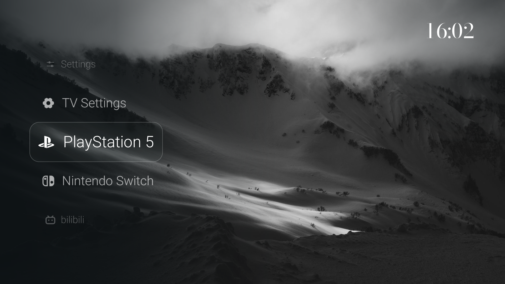

# Luma TV

一个适合遥控器操作的 Android TV 桌面：风景壁纸、竖向滚轮、横向 Dock，以及安静的时钟屏保。原生 Java 实现，无 WebView。



这是独立的 TV UI 开源版。仅包含界面与电视适配代码，默认使用五张有来源与许可记录的自然风景图片。

**[下载预览 APK](https://github.com/KyleshierArt/luma-tv/releases/tag/v0.6.0-public)** · [检查记录](docs/VALIDATION.md)

## 功能

- 竖向滚轮、纵向列表、横向 Dock 三种首页布局。
- 遥控器焦点、毛玻璃选中效果、入口排序与隐藏。
- 壁纸选择、定时轮播、开场欢迎动画。
- 风景时钟屏保、低亮度时钟模式、中英文界面。
- 本机应用列表、信号源页面与部分小米电视入口适配。
- 可选城市天气：首次使用由用户手动选择城市，不附带默认位置。

## 预览与兼容性

预览来自 Android TV 模拟器运行公开版 APK 的截图。见 [界面与测试记录](docs/VALIDATION.md)。模拟器用于检查布局和遥控器流程，不代表已验证实体电视的 HDMI、开机启动、HDR 或音视频功能。

最低 Android 8.0 / API 26，目标 API 34。小米适配代码保留 MiTV-MTSU0 与 MiTV-MTEQ0 的机型判断；其他设备可试用界面，系统入口可能不可用。PlayStation 5、Nintendo Switch 是可编辑的默认入口名称，分别指向 HDMI 1 / HDMI 2，不会自动识别设备。

公开版应用 ID：`io.github.op7418.lumatv.publicui`。使用独立偏好、缓存、时钟任务与测试证书，可与个人定制版并存。开机自动进入默认关闭；不自动配置系统启动目标，也不接管 Home 键。

## 构建

需要 JDK 17、Android SDK Platform 34、Build Tools 34.0.0、Python 3 与 Pillow。

```sh
python3 -m venv .venv
.venv/bin/pip install -r requirements-dev.txt
export JAVA_HOME=/path/to/jdk-17
export ANDROID_HOME=/path/to/Android/sdk
.venv/bin/python scripts/build_public.py --debug-sign
```

输出 `builds/luma-tv-public-preview.apk`，使用专门生成的本地预览证书；该证书不会进入源码归档。脚本只构建，不连接或安装到设备。不加 `--debug-sign` 可生成未签名 APK。

也可以使用 Gradle 8.9 或 Android Studio：

```sh
gradle :app:assembleDebug :app:testDebugUnitTest :app:lintDebug
```

Gradle Debug 产物位于 `app/build/outputs/apk/debug/app-debug.apk`。不同构建方式的测试签名可能不同，不能保证互相覆盖安装。正式分发前需使用维护者独立管理的发布证书；可通过 `LUMA_KEYSTORE`、`LUMA_STORE_PASSWORD`、`LUMA_KEY_ALIAS`、`LUMA_KEY_PASSWORD` 配置 Gradle Release 签名。

## 天气与隐私

不要求账号，不读取通讯录，不请求定位、录音或拍摄权限。未选择城市时，不发送天气请求。选择城市后，搜索关键词会发给 Open-Meteo 城市搜索服务；所选城市经纬度会发给 MET Norway 天气服务，服务提供商也可见请求 IP。城市与偏好仅保存在本机应用数据中。

公开源码和安装包只允许包含已审核资源。发布前执行：

```sh
.venv/bin/python scripts/check_public_release.py
.venv/bin/python scripts/check_public_release.py --apk builds/luma-tv-public-preview.apk
```

检查会拒绝私人配置、密钥文件、家庭网络地址、未经审核的图片和图片 EXIF / XMP 元数据，并逐项核对 APK 资源。详细发布边界见 [PRIVACY.md](PRIVACY.md)。

使用 `python scripts/package_source.py` 可生成仅含已审核源文件的归档；不要直接压缩整个工作目录，里面可能有被 Git 忽略的本地构建文件。

## 自定义与贡献

- 默认首页项目：`HomeItems.java`；小米接口：`XiaomiControls.java`。
- 壁纸与来源：`app/src/main/assets/wallpapers/catalog.json`。
- 翻译：编辑 `translations.json` 后运行 `python3 scripts/generate_translations.py`。
- 自用壁纸可使用 `scripts/prepare_wallpapers.py` 生成本地资源；发布检查会拒绝尚未审核的自用图片。公开分发前须审核来源、移除元数据并更新资源清单。

提交 Issue 时请使用演示图片，隐去账号、位置、序列号及调试信息。

## 来源与许可

代码采用 [MIT License](LICENSE)，保留原项目作者署名。工程衍生基础为 [Gathin23/cleanyourtv](https://github.com/Gathin23/cleanyourtv)，部分交互参考 [nthnclrk/CleanFrame](https://github.com/nthnclrk/CleanFrame)。图标、字体、壁纸各自适用其许可，见 [NOTICE.md](NOTICE.md) 与 [壁纸署名](docs/WALLPAPERS.md)。
