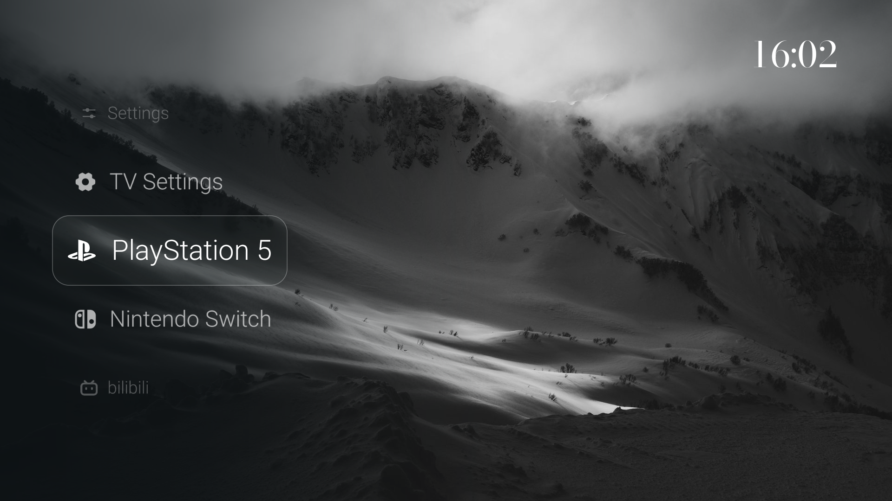

# 公开版检查记录

本次检查针对 Luma TV `0.6.0-public` 公开预览版。以下为发布前的本地验证记录；尚未安装到实体电视。

## 整理范围

- 保留竖向滚轮、列表、Dock、壁纸、欢迎动画、时钟、设置、应用列表与电视信号源界面。
- 使用五张有来源和许可记录的自然图片，首页和屏保不依赖个人照片。
- 移除家庭影像模块、专用入口、品牌图片、桥接程序及跨应用语言联动。
- 不打包默认城市、个人外观配置、实机记录、已有 APK、账号配置或原签名密钥。
- 使用独立应用 ID 和新生成的本地测试证书；公开源文件未继承原 Git 历史。

## 已完成检查

| 检查 | 结果 |
| --- | --- |
| SDK 原生构建（aapt2 / javac / d8） | 通过，源码归档解包后再次构建也通过 |
| APK v2 / v3 签名验证 | 通过，证书主体为通用预览名称 |
| Java 单元测试 | 37 项通过：外观值、Dock 滚动、壁纸轮播、启动策略、模糊与翻译、天气规则 |
| Python 测试 | 9 项通过：4 项壁纸工具测试、5 项发布边界测试 |
| 源文件与 APK 发布检查 | 通过：审核图片校验、元数据检查、资源一致性、配置与标识扫描 |
| 私有文件哈希比对 | 与 43 个私有资源、记录或配置文件比对，公开文件和 APK 解包内容未发现相同文件 |
| 原项目完整性 | 整理前记录的 273 个原项目文件，整理后校验均未变化；未对实体电视执行任何操作 |
| 默认位置与启动状态 | 运行记录显示城市未设置、天气请求次数为 0、开机自动进入关闭 |
| Android Runtime 错误 | 本次模拟器交互期间未记录到 AndroidRuntime 错误 |

发布边界测试使用临时副本与合成数据，验证干净源码可通过，同时拒绝新增位置配置、未审核图片、写死的家庭网络地址与多余 APK 资源。

## 实际运行预览

截图来自独立 Android TV API 31 / ARM64 模拟器，1920 × 1080、320 dpi。已检查三种布局、设置页、中英文切换、信号源页面、风景时钟及按返回键退出时钟。截图中的游戏机名称是默认示例标签。

| 画面 | 预览 |
| --- | --- |
| 竖向滚轮首页 | [英文](screenshots/home.png) · [中文](screenshots/home-zh.png) |
| 横向 Dock | [查看](screenshots/dock.png) |
| 纵向列表 | [查看](screenshots/list.png) |
| 设置 | [查看](screenshots/settings.png) |
| 信号源 | [查看](screenshots/inputs.png) |
| 语言设置 | [查看](screenshots/language-zh.png) |
| 风景时钟 | [查看](screenshots/clock.png) |

## 验证范围

未运行本公开版的实体电视回归、实际 HDMI 切换、系统开机配置、HDR / VRR、长期稳定性或天气服务联网测试。Gradle / Android lint 和 GitHub Actions 尚未在本次本地检查中执行；仓库已提供相应 CI 配置。

自动扫描不覆盖任意编码、转码、加密或隐写数据。此次整理通过明确文件范围、资源清单、源码与 APK 双重检查及人工看图降低误带入私人内容的风险，不把单次扫描视为永久保证。
